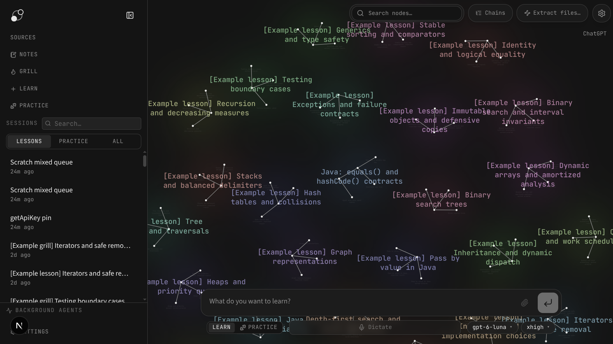
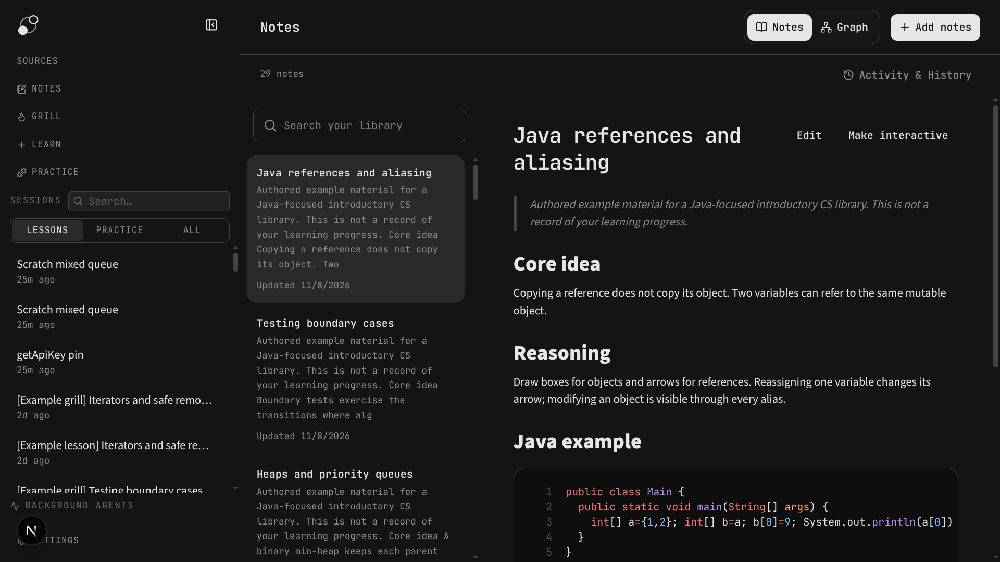
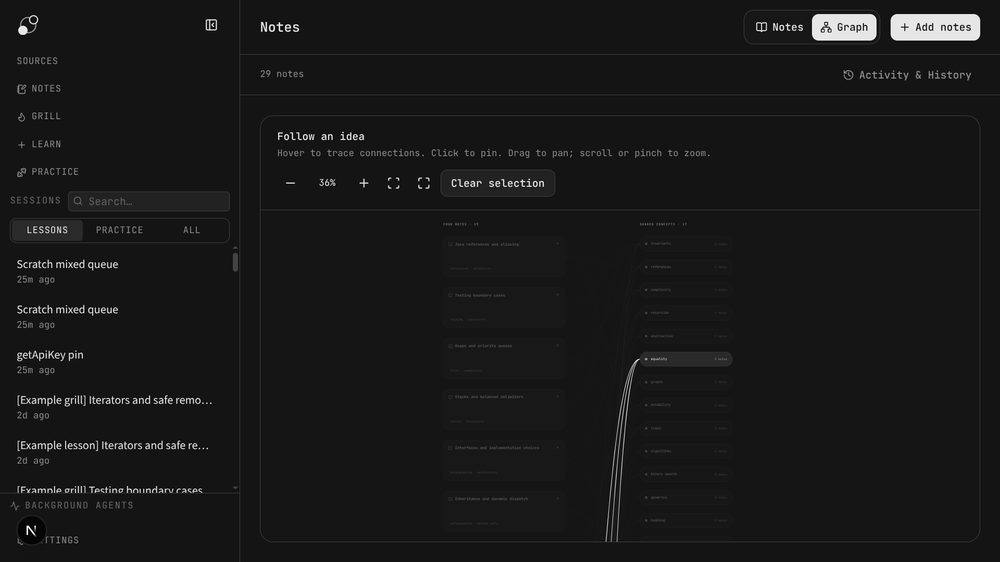

<p align="center">
  <picture>
    <source media="(prefers-color-scheme: dark)" srcset="docs/assets/lh_banner_dark.png">
    <source media="(prefers-color-scheme: light)" srcset="docs/assets/lh_banner_light.png">
    
  </picture>
</p>

<p align="center"><strong>A personal learning workspace built on LearnHarness.</strong></p>

This fork of [LearnHarness](https://github.com/amosblomqvist/learnharness) combines AI-guided lessons, assessment, coding exercises, a source library, and independent notes. Bring your own model connection and keep your learning records on your machine.



## Explore the workspace

- **Learn:** start a lesson with a short, skippable diagnostic, a graphical lesson map, explanations, and a learner-started grill. Choose guided advancement or strict mastery for each session.
- **Grill:** start with assessment when you already know the topic, then work through gaps. **Practice** remains available for separate problem-solving sessions.
- **Sources:** group text, code, Markdown, text-based PDFs, or webpages under a learning goal. Generate and review a source-grounded roadmap, then lock the materials and start lessons.
- **Coding exercises:** write Java, Go, Python, JavaScript, or TypeScript in the lesson workspace. Run examples or submit against the full case set using local Docker runners.
- **Notes:** add snippets to an independent library, search and edit topic pages, review changes and conflicts, and explore connections in a separate notes graph.
- **Learning graph:** browse propositions and reasoning chains extracted from sessions and imported material. It is a knowledge map, not a mastery score.





See the [fork feature guide](docs/personal-learning-harness.md) for workflows, prerequisites, and boundaries. The screenshots show example content.

## Get started

Linux x64 packages are intended for [this fork's GitHub Releases](https://github.com/NWGKGIT/learnharness/releases), with AppImage, Debian, RPM, and Arch/pacman builds configured in the release workflow. See [desktop releases](docs/desktop-release.md) for the current build and release process.

To run from source with Node 26:

```bash
npm ci
npm run plugins:setup
npm run dev        # http://localhost:3000
```

Configure models under **Settings → Providers** and choose model slots before starting a lesson. Coding exercises additionally require Docker and [local runner setup](scripts/runners/README.md). See [Getting started](docs/getting-started.md) and [Development](docs/development.md) for details.

## Data and services

Chats, learning state, notes, source records, settings, and credentials are stored locally. Local storage does not mean offline processing: configured model providers, web research, and dictation can receive the content needed for their tasks. API keys are stored as plaintext files with restrictive permissions; keep your profile private. See [data and privacy](docs/getting-started.md#data-privacy-and-usage).

## Documentation and support

Start with the [documentation index](docs/README.md), [architecture](docs/architecture.md), [keyboard shortcuts](docs/keyboard.md), and [plugin authoring](docs/plugin-authoring.md). Report fork issues at [NWGKGIT/learnharness](https://github.com/NWGKGIT/learnharness/issues). For security reporting, see [SECURITY.md](SECURITY.md).

## License and attribution

This project is licensed under [AGPL-3.0](LICENSE). It is a fork of [amosblomqvist/learnharness](https://github.com/amosblomqvist/learnharness); see its repository for the upstream project.
