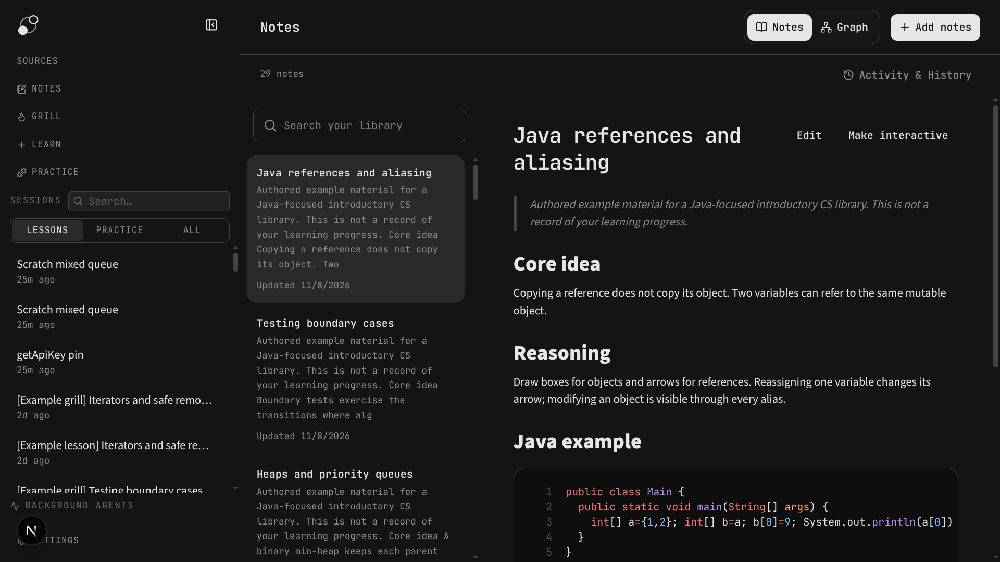
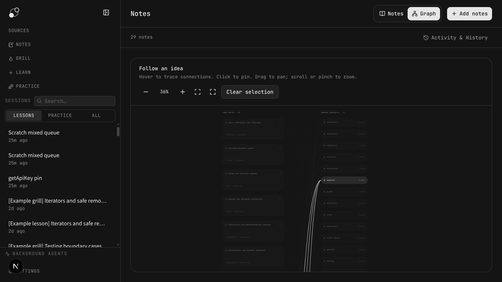

# Learning workspace

This guide covers the additional learning workflows in this fork. Configure a model in **Settings → Providers** before starting a lesson or using model-powered organization and roadmap generation. For setup, see [Getting started](getting-started.md).

## Learn and Grill

Choose **Learn**, enter a topic, and select an advancement mode:

- **Guided** allows you to continue while recording gaps.
- **Strict mastery** requires evidence for each objective before advancement.

A lesson can begin with a short diagnostic, which you can skip. It then presents a graphical map and explanations for its sections. Start the **Grill** when you are ready to assess an explanation; review and retest gaps as the session progresses. The map and phase history make the current position visible. An assessment that used revealed exercise cases is treated as assisted; a fresh task is needed for unassisted evidence.

Choose **Grill** from the sidebar to assess a topic without the initial diagnostic and explanation. It prepares an outline and objectives first. **Practice** is a separate existing workflow for problem sessions.

## Coding exercises

A lesson can include a single-file coding exercise in Java, Go, Python, JavaScript, or TypeScript. The editor keeps a local draft and accepts standard input. **Run** executes visible examples; **Submit** runs the complete set and shares the recorded result with the tutor. Hidden cases become visible after submission. Passing cases alone does not establish mastery.

The tutor-generated reference solution is checked against the exercise cases before the exercise is offered. Execution requires Docker and configured image IDs; there is no host-execution fallback. Follow [Local exercise runtimes](../scripts/runners/README.md) before using the runner. Image setup may require downloads and building local images.

## Sources and roadmaps

1. Open **Sources** and create a learning goal.
2. Add pasted text, code, Markdown, a webpage, or an uploaded text/code/Markdown file or text-based PDF. Files and webpages are limited to 20 MB; scanned PDFs require OCR beforehand.
3. Generate a roadmap, inspect its lessons, dependencies, objectives, and source passages, and regenerate it if needed.
4. Confirm the permanent lock of that goal's materials and roadmap, select an advancement mode, and start a lesson.

Source changes invalidate an unlocked draft roadmap. A locked goal cannot be edited or regenerated; create another goal for a different set of materials. Source-backed lesson instructions direct the tutor to cite passages and identify additional context. Model-generated roadmaps and explanations should be reviewed against the source.

## Notes

The **Notes** workspace is an independent library: pasted snippets are organized into topic pages, with search, editing, original snippets, conflict review, and revision history. Related additions can be merged and duplicates skipped. The **Graph** view links notes through shared concepts; it is separate from the lesson knowledge graph and does not automatically connect notes to lessons or Sources.

Organization uses a configured model. Local Ollama embeddings can help rank related pages; when unavailable, the workspace falls back to text matching and reports that limitation. Originals are retained for review and retry if organization fails.

## Storage and privacy

Lesson state, source-library state, and Notes use separate local SQLite stores alongside the existing chat and graph data. Model providers can receive the material needed for their work; local storage is not a guarantee of offline processing. See [Getting started: data and privacy](getting-started.md#data-privacy-and-usage).
